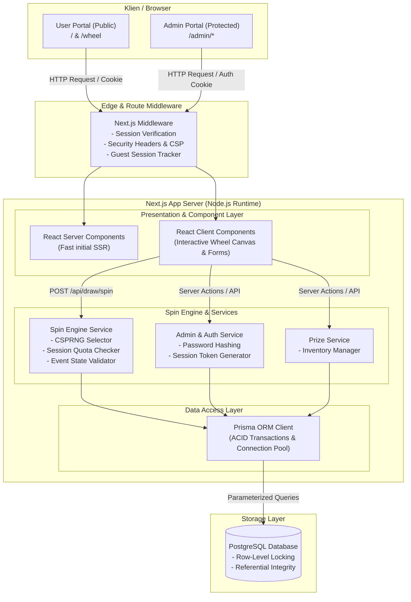
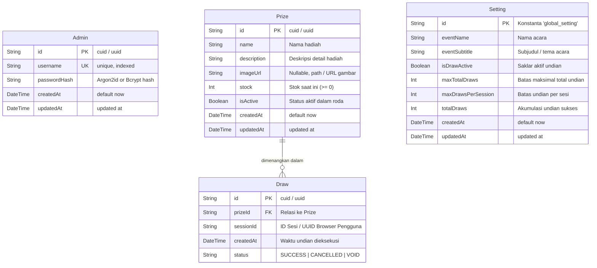
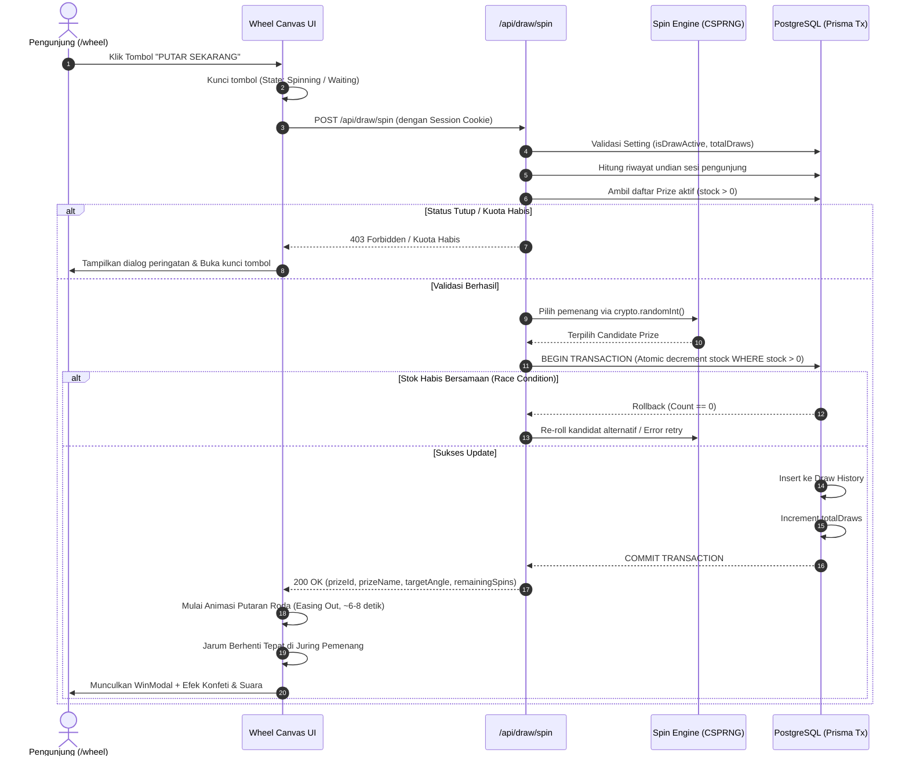

# Dokumen Arsitektur & Desain Teknis (System Architecture & Technical Design)
## Proyek: LUCKY WHEEL - Interactive Event Lucky Draw Platform

---

### 1. Gambaran Arsitektur Sistem (High-Level Architecture)

LUCKY WHEEL mengadopsi pola arsitektur **Full-Stack Monolith** modern menggunakan **Next.js App Router** dalam satu kesatuan basis kode (*single codebase*). Seluruh proses rendering UI, penyajian aset statis, API endpoints/Server Actions, autentikasi sesi, serta interaksi ke basis data PostgreSQL dijalankan secara terpadu.



---

### 2. Entity Relationship Diagram (ERD Database)

Skema basis data dirancang untuk mendukung integritas data undian dan pelacakan riwayat secara presisi.



---

### 3. Rincian Skema Data & Relasi (Prisma Data Models)

```prisma
datasource db {
  provider = "postgresql"
  url      = env("DATABASE_URL")
}

generator client {
  provider = "prisma-client-js"
}

model Admin {
  id           String   @id @default(cuid())
  username     String   @unique
  passwordHash String
  createdAt    DateTime @default(now())
  updatedAt    DateTime @updatedAt

  @@map("admins")
}

model Prize {
  id          String   @id @default(cuid())
  name        String
  description String?  @db.Text
  imageUrl    String?
  stock       Int      @default(0)
  isActive    Boolean  @default(true)
  createdAt   DateTime @default(now())
  updatedAt   DateTime @updatedAt
  draws       Draw[]

  @@index([isActive, stock])
  @@map("prizes")
}

model Draw {
  id        String   @id @default(cuid())
  prizeId   String
  prize     Prize    @relation(fields: [prizeId], references: [id], onDelete: Restrict)
  sessionId String   @db.VarChar(128)
  status    String   @default("SUCCESS") @db.VarChar(32)
  createdAt DateTime @default(now())

  @@index([sessionId])
  @@index([prizeId])
  @@index([createdAt])
  @@map("draws")
}

model Setting {
  id                 String   @id @default("global_setting")
  eventName          String   @default("LUCKY WHEEL EVENT")
  eventSubtitle      String?  @default("Putar roda dan menangkan hadiah menarik!")
  isDrawActive       Boolean  @default(false)
  maxTotalDraws      Int      @default(100)
  maxDrawsPerSession Int      @default(1)
  totalDraws         Int      @default(0)
  createdAt          DateTime @default(now())
  updatedAt          DateTime @updatedAt

  @@map("settings")
}
```

---

### 4. Struktur Folder Next.js App Router

Struktur folder mengusung prinsip modularitas, pemisahan tanggung jawab (*separation of concerns*), dan keamanan arsitektur App Router:

```
lucky-wheel/
├── .env.example
├── .gitignore
├── next.config.mjs
├── package.json
├── postcss.config.mjs
├── tailwind.config.ts
├── tsconfig.json
├── prisma/
│   ├── schema.prisma               # Definisi skema basis data Prisma
│   └── seed.ts                     # Script seeder untuk Admin & Default Setting
├── public/
│   ├── audio/                      # Audio efek (spin.mp3, win.mp3)
│   ├── images/                     # Aset gambar default/placeholder
│   └── favicon.ico
├── src/
│   ├── middleware.ts               # Proteksi rute admin & session cookie tracking
│   ├── app/
│   │   ├── layout.tsx              # Root layout publik (font, toast provider)
│   │   ├── page.tsx                # Landing Page publik (/)
│   │   ├── wheel/
│   │   │   └── page.tsx            # User Portal Roda Undian (/wheel)
│   │   ├── admin/
│   │   │   ├── layout.tsx          # Admin layout (Sidebar, Navbar, Auth Guard)
│   │   │   ├── page.tsx            # Admin Dashboard ringkasan statistik (/admin)
│   │   │   ├── login/
│   │   │   │   └── page.tsx        # Halaman Login Admin (/admin/login)
│   │   │   ├── prizes/
│   │   │   │   └── page.tsx        # Manajemen Master Hadiah (/admin/prizes)
│   │   │   ├── draw-history/
│   │   │   │   └── page.tsx        # Riwayat Undian & Ekspor Data (/admin/draw-history)
│   │   │   └── settings/
│   │   │       └── page.tsx        # Pengaturan Acara & Toggle Undian (/admin/settings)
│   │   └── api/
│   │       ├── draw/
│   │       │   ├── spin/route.ts   # Core Engine: POST Endpoint Pemutaran Undian
│   │       │   └── status/route.ts # Polling ringan status undian & sisa kuota sesi
│   │       ├── admin/
│   │       │   ├── auth/
│   │       │   │   ├── login/route.ts  # Endpoint login admin
│   │       │   │   └── logout/route.ts # Endpoint logout admin
│   │       │   └── export/
│   │       │       └── csv/route.ts    # Download CSV riwayat undian
│   ├── components/
│   │   ├── common/                 # Komponen umum (Button, Modal, Input, Badge, Toast)
│   │   ├── wheel/
│   │   │   ├── WheelCanvas.tsx     # Komponen rendering HTML5 Canvas roda
│   │   │   ├── WheelControls.tsx   # Tombol Spin & indikator status
│   │   │   ├── WinModal.tsx        # Dialog selebrasi kemenangan + Confetti
│   │   │   └── SessionBadge.tsx    # Informasi sisa kuota undian user
│   │   └── admin/
│   │       ├── AdminSidebar.tsx    # Navigasi panel admin
│   │       ├── AdminHeader.tsx     # Profil admin, quick switch, & logout
│   │       ├── PrizeFormModal.tsx  # Modal form tambah/edit hadiah
│   │       ├── PrizeTable.tsx      # Tabel data hadiah + inline toggle
│   │       └── HistoryTable.tsx    # Tabel riwayat undian dengan pagination
│   ├── lib/
│   │   ├── prisma.ts               # Prisma Client singleton
│   │   ├── auth.ts                 # Utilitas enkripsi sesi admin & JWT/Iron-session
│   │   ├── session.ts              # Pengelola sesi browser pengunjung
│   │   ├── random.ts               # CSPRNG helper (crypto.randomInt)
│   │   ├── validations/            # Skema validasi Zod
│   │   │   ├── auth.schema.ts      # Validasi form login
│   │   │   ├── prize.schema.ts     # Validasi hadiah
│   │   │   └── setting.schema.ts   # Validasi pengaturan acara
│   │   └── sound.ts                # Audio manager untuk efek suara
│   └── types/
│       ├── wheel.ts                # Definisi tipe juring roda, status, & hasil
│       └── db.ts                   # Ekstensi tipe model database
```

---

### 5. Mekanisme Spin Engine & Penanganan Concurrency (Anti Race-Condition)

Salah satu tantangan kritis aplikasi ini adalah **Race Condition**: ketika banyak pengunjung menekan tombol spin secara bersamaan pada hadiah yang tersisa 1 buah stok.

#### Algoritma & Urutan Eksekusi Transaksi Server-Authoritative

1. **Pemeriksaan Awal (Fast-Fail Check)**:
   - Ambil `Setting` global. Pastikan `isDrawActive === true`.
   - Pastikan `totalDraws < maxTotalDraws`.
   - Ambil `sessionId` dari *cookie* pengunjung. Hitung jumlah undian pada tabel `Draw` untuk sesi ini. Pastikan `sessionDrawCount < maxDrawsPerSession`.
2. **Koleksi Kandidat Hadiah**:
   - Ambil seluruh hadiah dengan kondisi `isActive === true AND stock > 0`.
   - Jika tidak ada hadiah tersisa, hentikan proses dan kembalikan pesan "Hadiah Telah Habis".
3. **Pemilihan Pemenang dengan CSPRNG**:
   - Gunakan `crypto.randomInt(0, candidates.length)` dari modul bawaan Node.js `node:crypto`.
   - Terpilih satu `candidatePrizeId`.
4. **Transaksi Atomik Database dengan Validasi Stok Ketat (ACID)**:
   - Jalankan `prisma.$transaction` yang mengunci integritas stok:
   ```typescript
   const result = await prisma.$transaction(async (tx) => {
     // 1. Verifikasi kembali batas total undian secara terisolasi
     const currentSetting = await tx.setting.findUnique({
       where: { id: "global_setting" }
     });
     if (!currentSetting?.isDrawActive || currentSetting.totalDraws >= currentSetting.maxTotalDraws) {
       throw new Error("DRAW_INACTIVE_OR_LIMIT_REACHED");
     }

     // 2. Verifikasi kembali kuota sesi pengunjung
     const sessionCount = await tx.draw.count({
       where: { sessionId, status: "SUCCESS" }
     });
     if (sessionCount >= currentSetting.maxDrawsPerSession) {
       throw new Error("SESSION_LIMIT_EXCEEDED");
     }

     // 3. Kurangi stok secara kondisional (Pencegahan Race Condition)
     // Eksekusi update langsung dengan klausa WHERE stock > 0
     const updatedPrize = await tx.prize.updateMany({
       where: {
         id: selectedPrize.id,
         stock: { gt: 0 },
         isActive: true,
       },
       data: {
         stock: { decrement: 1 },
       },
     });

     if (updatedPrize.count === 0) {
       // Stok telah terambil oleh request konkuren lain tepat sebelum transaksi ini
       throw new Error("PRIZE_OUT_OF_STOCK_RETRY");
     }

     // 4. Buat catatan riwayat undian
     const newDraw = await tx.draw.create({
       data: {
         prizeId: selectedPrize.id,
         sessionId: sessionId,
         status: "SUCCESS",
       },
     });

     // 5. Inkrementasi total undian acara
     await tx.setting.update({
       where: { id: "global_setting" },
       data: { totalDraws: { increment: 1 } },
     });

     return { newDraw, selectedPrize };
   });
   ```
5. **Kalkulasi Sudut Rotasi Target untuk Frontend**:
   - Hitung sudut juring target (`targetAngle = (360 / totalActivePrizes) * targetIndex`).
   - Tambahkan rotasi putaran penuh (misal 5 hingga 8 putaran penuh: `extraRounds = 5 * 360`) ditambah *random jitter* offset aman di dalam juring agar jarum tidak selalu berhenti di titik tengah persis.

---

### 6. Diagram Alur Undian (Sequence Diagram)



---

### 7. Keamanan & Proteksi Sistem (Security Architecture)

1. **Zero-Trust Frontend**:
   - Frontend sama sekali tidak dipercaya untuk kalkulasi bisnis apa pun. Klien tidak pernah mengirimkan nama hadiah yang "diinginkan". Frontend hanya mengirim *intent to spin*.
2. **Session Cookie Aman untuk Pengunjung**:
   - Menggunakan *signed HTTP-only cookie* (`lucky_wheel_session_id`) yang digenerate oleh server saat pertama kali membuka situs. Dilengkapi atribut `SameSite=Lax` dan `Secure=true` (pada lingkungan produksi).
3. **Autentikasi Admin Tanpa Kebocoran**:
   - Password di-hash menggunakan algoritma modern **Argon2id** (atau bcrypt salt round 12).
   - Sesi admin disimpan dalam token sesi *encrypted/signed* (`admin_session`) yang memiliki masa berlaku (*expiry time*).
   - Password hash tidak pernah disertakan dalam query select ke client (`select: { id: true, username: true }`).
4. **Validasi Input Ketat dengan Zod**:
   - Setiap payload request ke API (login, tambah/edit hadiah, ubah setting) divalidasi dengan Zod schema sebelum menyentuh logika bisnis atau database.
5. **Perlindungan Terhadap Rate Limiting & DoS**:
   - Menerapkan pembatasan frekuensi klik spin per session (misal cooldown 10 detik sebelum putaran selesai dan tombol dapat diakses kembali).
6. **Proteksi CORS & CSRF**:
   - Route handlers hanya menerima metode POST dengan origin yang sama (*same-origin check*).

---

### 8. Analisis Risiko Teknis & Keamanan (Risk Assessment)

| Kategori | Risiko Potensial | Dampak | Tingkat Risiko | Strategi Mitigasi Terencana |
| :--- | :--- | :--- | :---: | :--- |
| **Konkurensi** | *Race condition* pada stok hadiah terakhir (misal 10 user spin bersamaan memperebutkan 1 hadiah tersisa). | Stok menjadi minus, hadiah dikeluarkan melebihi ketersediaan nyata (*overselling*). | **Tinggi (High)** | Menggunakan atomic update Prisma `stock: { decrement: 1 }` dengan syarat `stock: { gt: 0 }` di dalam transaksi database serial/ACID. Jika update count = 0, transaksi otomatis dibatalkan/diulang. |
| **Integritas** | Manipulasi DevTools / Network injection oleh pengguna untuk menentukan hadiah sendiri. | Pengguna curang mendapatkan hadiah bernilai tinggi. | **Kritis (Critical)** | Arsitektur *Server-Authoritative*: server yang menentukan pemenang dan mencatat ke database sebelum mengirim informasi visual ke browser. |
| **Koneksi Klien** | Koneksi internet user putus saat animasi roda sedang berputar. | User tidak melihat animasi, tetapi data di database sudah tercatat menang. | **Sedang (Medium)** | Hasil undian sudah tersimpan di database. Sistem menyediakan modal "Hasil Undian Terakhir" atau sinkronisasi state saat halaman di-refresh. |
| **Keamanan Akun** | Serangan *Brute Force* pada endpoint `/admin/login`. | Pengambilalihan akun administrator dan sabotase acara. | **Tinggi (High)** | Penerapan *rate-limiter* (maksimal 5 percobaan gagal per IP/username per 15 menit), password minimum 8 karakter, dan session timeout. |
| **Performa UI** | Animasi roda patah-patah (*lagging*) pada ponsel berspesifikasi rendah. | Pengalaman pengguna acara terganggu. | **Rendah (Low)** | Menggunakan HTML5 Canvas murni yang dioptimalkan dengan `requestAnimationFrame` dan kurva Bézier / cubic easing murni, membatasi redraw yang tidak perlu. |

---

### 9. Rencana Implementasi Bertahap (Phased Implementation Plan)

- **Tahap 1: Inisialisasi Proyek & Fondasi Lingkungan (Foundational Setup)**
  - Setup Next.js App Router (TypeScript, Tailwind CSS, Lucide Icons, Canvas-Confetti).
  - Setup Prisma ORM, konfigurasi skema model basis data (`Admin`, `Prize`, `Draw`, `Setting`), dan migrasi awal ke PostgreSQL.
  - Pembuatan script *database seeder* untuk inisialisasi akun Administrator awal dan pengaturan global default.

- **Tahap 2: Infrastruktur Keamanan, Autentikasi Admin & Sesi Publik**
  - Implementasi utilitas hashing password (Argon2 / Bcrypt) dan tokenisasi sesi aman.
  - Pembuatan Next.js Edge Middleware untuk proteksi rute `/admin/*` dan inisialisasi `sessionId` pengunjung.
  - Implementasi form login admin (`/admin/login`), API handler login/logout, dan verifikasi status sesi.

- **Tahap 3: Manajemen Admin Portal (Prizes, History, Settings)**
  - Pembuatan antarmuka Dasbor Admin (`/admin`) dengan metrik statistik acara.
  - Pembuatan modul Master Hadiah (`/admin/prizes`): CRUD hadiah, upload/input URL gambar, toggle status aktif, dan pengelolaan stok.
  - Pembuatan modul Riwayat Undian (`/admin/draw-history`) beserta fitur filter dan ekspor CSV.
  - Pembuatan modul Pengaturan Acara (`/admin/settings`): toggle saklar undian, batas total undian, dan batas per sesi.

- **Tahap 4: Core Spin Engine & Server-Side Atomic Handler**
  - Pembuatan API route `/api/draw/spin` dengan validasi Zod ketat.
  - Implementasi logika pemilihan acak aman (CSPRNG) dan transaksi atomik Prisma anti race-condition.
  - Implementasi endpoint `/api/draw/status` untuk penyelarasan status undian dan sisa kuota secara berkala.

- **Tahap 5: User Portal & Animasi Interaktif Roda Keberuntungan**
  - Implementasi komponen HTML5 Canvas Roda Keberuntungan (`WheelCanvas.tsx`): rendering juring, teks hadiah, warna dinamis, dan jarum penunjuk.
  - Implementasi mesin animasi fisika putaran (*easing deceleration curve*) yang menyelaraskan derajat target dari respons server.
  - Integrasi efek suara putaran dan kemenangan (*sound effects*) serta efek visual selebrasi konfeti.
  - Pembuatan Halaman Landing (`/`) dan Portal Roda (`/wheel`) yang responsif untuk berbagai ukuran layar.

- **Tahap 6: Pengujian Kualitas, Uji Konkurensi & Finalisasi**
  - Pengujian simulasi beban konkurensi putaran simultan untuk menjamin nol *overselling*.
  - Audit keamanan terhadap bypass otentikasi dan manipulasi parameter sesi.
  - Pengujian responsivitas pada perangkat mobile dan layar lebar (*projector mode*).
  - Penyusunan dokumentasi operasional untuk panitia acara (*Runbook*).
